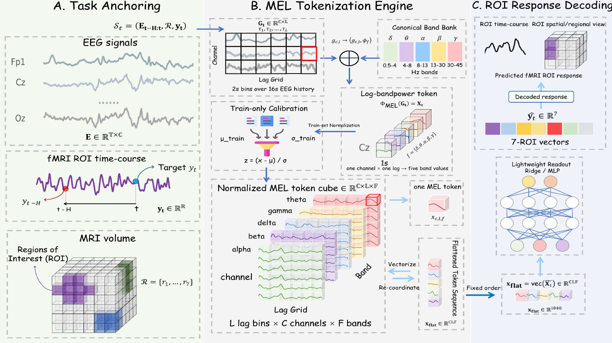

# MEL

**MEL: Coordinate-Preserving EEG Tokenization for fMRI Translation**

[Paper](https://arxiv.org/abs/2608.29304)

MEL converts the EEG history preceding each fMRI target time into calibrated
lag-channel-frequency measurements, then predicts regional BOLD time courses
with Ridge regression or a compact MLP.

This repository contains the **main matched-readout experiment only**. Ablations,
mechanism controls, external experiments, participant-exclusion experiments and
historical prediction collectors are not included.

## Method

- **Target-relative history:** 16 seconds of EEG, eight two-second bins and 26 channels.
- **Spectral measurement:** canonical Fourier, uniform Fourier, whole-history spectrum or Morlet energy; 1040 features each.
- **Calibrated readout:** training-only feature calibration, target-specific Ridge selection or a matched 16-hidden-unit MLP.
- **Prediction ensemble:** average predictions from five validation-selected MLP seeds, not the best test seed.

## Framework



The diagram shows the canonical Fourier interface. The main implementation also
compares alternative spectral estimators through the same readout interface.

## Main Results

Recorded mean scan-wise Pearson correlation across 29 resting-state scans from
22 participants, averaged over six regional targets and the global signal:

| Representation | Ridge | MLP | MLP Ensemble |
| --- | ---: | ---: | ---: |
| Canonical Fourier | 0.432 | 0.374 | 0.431 |
| Uniform Fourier | 0.456 | 0.368 | 0.429 |
| Whole-history spectrum | 0.363 | 0.302 | 0.356 |
| MEL-Morlet | **0.508** | **0.433** | **0.491** |

MLP scores first average the five seed scores within each scan. Ensemble scores
average prediction vectors before scoring. These are archived experimental
results, not new runs of this reorganized release. A single-scan run is not the
29-scan cohort result. Reference scores are in reference_results/.

## Installation

Use Python 3.11. With Conda:

```bash
conda env create -f create_env.yaml
conda activate mel
```

Or install into an isolated Python environment:

```bash
python -m venv .venv
```

Activate the environment before installing: `.\.venv\Scripts\Activate.ps1` in PowerShell,
or `source .venv/bin/activate` on Linux/macOS. Then install:

```bash
python -m pip install --extra-index-url https://download.pytorch.org/whl/cpu -r requirements-preprocessing.txt
```

Aligned-cache users need only
requirements.txt; requirements-preprocessing.txt adds raw EEGLAB input support.
The Windows CPU lock file preserves the earlier reference dependency pins.
CUDA runs require a compatible PyTorch installation.

## Data Preparation

Obtain the [NeuroBOLT resting-state dataset](https://huggingface.co/datasets/NeurdyLab/NeuroBOLT)
under its original conditions. Keep each EEGLAB .set file beside its companion
.fdt file. Point DATA_ROOT to this layout:

```text
DATA_ROOT/
  EEG/
    sub01-scan01_eeg.set
    sub01-scan01_eeg.fdt
  fMRI_difumo/
    sub01-scan01_difumo64_roi.pkl
```

```bash
python data/prepare.py --data-root DATA_ROOT --scans sub01-scan01
```

Only load trusted pickle files. Preparation retains the inherited retrospective
whole-scan BOLD filtering/normalization, chronological splits and ten-TR guards.
The verified storage order is thalamus, putamen, cuneus, Heschl's gyrus, anterior
middle frontal gyrus, anterior precuneus and global signal. For anatomical-group
display order, use zero-based indices `[2, 3, 4, 5, 1, 0, 6]` after prediction;
do not reorder response columns before seeded MLP fitting.

## Run Main Experiments

Run Ridge or all five MLP seeds and their prediction ensemble:

```bash
bash run_ridge.sh sub01-scan01
bash run_mlp.sh sub01-scan01
```

Pass more scan identifiers to evaluate more scans. On Linux/macOS with CUDA:

```bash
DEVICE=cuda bash run_mlp.sh sub01-scan01
```

On Windows PowerShell, or to customize directories:

```bash
python model/run.py --scans sub01-scan01 --readouts ridge --output-dir results/main_ridge --check-reference
python model/run.py --scans sub01-scan01 --readouts mlp --output-dir results/main_mlp
```

Missing feature caches are built automatically. Outputs include selection.json,
model states, predictions, per_run.csv, per_scan.csv and run_manifest.json.
Selection uses validation correlation only, and the choices are persisted before
evaluation targets are read. Existing nonempty output directories are not
overwritten. Use a new `--output-dir`, or set OUTPUT_DIR for the Bash scripts.
Run `python model/run.py --help` for all options.

## Repository Layout

```text
Fig/                 Framework image
data/                Raw-data preparation and canonical feature construction
model/               Spectral estimators, Ridge/MLP and the main training entry
configs/             Fixed main-experiment recipe
reference_results/   Archived main-experiment scores
tests/               Main-experiment unit-test code
create_env.yaml      Conda environment definition
run_ridge.sh         Main Ridge experiment
run_mlp.sh           Main MLP experiment and prediction ensemble
```

## Reproduction Scope

This source reorganization was checked statically only. No experiments or tests
were executed for this revision at the author's request. Earlier one-scan CPU
checks do not establish exact reproduction of historical CUDA MLP scores.
Ridge reference checks use declared mean/ROI tolerances of 0.0001/0.001; MLP
CPU/CUDA equivalence remains uncertified. The cohort's test splits were previously
inspected, and inherited BOLD preprocessing is not split-aware. The results do
not constitute fresh validation, prospective monitoring or clinical evidence.

## Citation

If you find this work useful, please cite our paper:

```bibtex
@article{liu2026mel,
  title={MEL: Coordinate-Preserving EEG Tokenization for fMRI Translation},
  author={Liu, Xiangyu and Yan, Zeting and Yin, Zhitong and Li, Boyang and Zhang, Xi},
  journal={arXiv preprint arXiv:2608.29304},
  year={2026}
}
```

Machine-readable citation metadata is available in [CITATION.cff](CITATION.cff).
Please also cite NeuroBOLT when using its dataset or adapted preprocessing code.

## Acknowledgments

We sincerely thank the authors of
[NeuroBOLT](https://github.com/soupeeli/NeuroBOLT) for making their implementation
and [resting-state EEG-fMRI dataset](https://huggingface.co/datasets/NeurdyLab/NeuroBOLT)
publicly available. Our data-loading and preprocessing routines are adapted from
their code, which provides an important foundation for this work. We appreciate
their contribution to open and reproducible EEG-to-fMRI research.

## License

This project retains the GPLv3 license. See [LICENSE](LICENSE) for the license
terms and [NOTICE.md](NOTICE.md) for upstream attribution.
